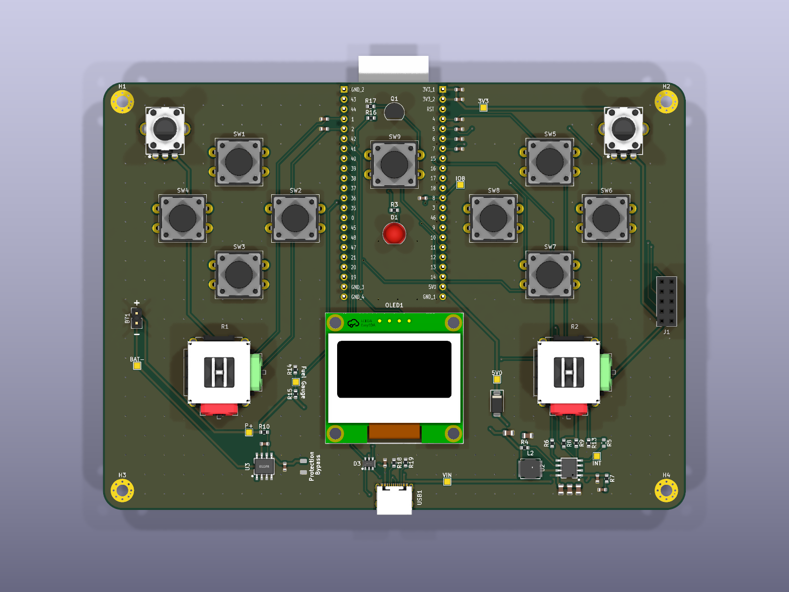

# EWU ASME SDC 2027 Transmitter

> A custom handheld Operator Console for the EWU ASME chapter's 2027 ASME Student Design Competition robot, built around an ESP32-S3 on a custom PCB. **Work in progress.**

<p align="center">
  
</p>

> This repo covers only the transmitter. The competition rules, playfield models, and the robot itself are in the main repo: [EWU-ASME-SDC-2027-Robot](https://github.com/SethHibpshman/EWU-ASME-SDC-2027-Robot).

## Table of Contents

- [Overview](#overview)
- [Status](#status)
- [Functionality](#functionality)
- [System Design](#system-design)
- [Author](#author)
- [AI Disclosure](#ai-disclosure)
- [License](#license)

## Overview

The 2027 ASME Student Design Competition, PODIUM, has one robot compete in five Disciplines. Each Run starts with a 30-second autonomous phase and ends with a 2-minute crewed phase, where the team drives the robot through its own Operator Console. ASME doesn't provide a control system, and the rules allow exactly one control link on a license-free band.

Instead of reusing the hobby RC radio from the [2026 robot](https://github.com/SethHibpshman/EWU-ASME-SDC-2026-Robot), this project is a purpose-built controller: an ESP32-S3 dev board on a custom PCB with joysticks, potentiometers, buttons, a display, and its own rechargeable battery system.

## Status

🚧 **Rev A is still being designed and has not been ordered.** The schematic and layout are in progress, and firmware has not been started. The fabrication files in [`/hardware/fabrication`](/hardware/fabrication) are working drafts, not a final release.

## Functionality

| Feature | Part |
|---|---|
| **Microcontroller** | ESP32-S3-DevKitC-1 N16R8 on headers |
| **Drive inputs** | 2x 2-axis analog joysticks (YF16-FL7.2-B5KA) |
| **Proportional inputs** | 2x rotary potentiometers (RK09K1130AAU) |
| **Buttons** | 8 action buttons and a power button |
| **Display** | I2C OLED (HS13L03W2C01), plus a status LED |
| **Battery** | Single 18650 cell |
| **Charging and power** | IP5306-I2C charger and 5 V boost |
| **Expansion** | 2 x 5 header for spare I/O |

## System Design

### Hardware

Designed in KiCad 10 as a two-sheet schematic: the main sheet (ESP32-S3, inputs, display, and expansion header) and a separate Battery Charging & Protection sheet. All project files are in [`/hardware/kicad_project_files`](/hardware/kicad_project_files). Passives use 0805 packages and the board has exposed test pads, so it can be hand-soldered and assembled in-house to keep cost down.

### Software

Not started.

```
EWU-ASME-SDC-2027-Transmitter/
├── assets/
│   └── pcb_render_top.png                       # 3D render of the PCB
└── hardware/
    ├── kicad_project_files/
    │   ├── transmitter.kicad_pro                # KiCad project
    │   ├── transmitter.kicad_sch                # Main schematic sheet
    │   ├── Battery Charging & Protection.kicad_sch
    │   └── transmitter.kicad_pcb                # PCB layout
    └── fabrication/                             # Draft JLCPCB outputs
        ├── gerber/                              # Gerbers and drill files
        └── production_files/                    # BOM, CPL, and Gerber zip
```

## Author

**Seth Hibpshman**  
Student of Electrical Engineering, Eastern Washington University

## AI Disclosure
_AI (LLM) tools were used in the drafting and editing of this README._

## License

[GNU General Public License v3.0](LICENSE)
