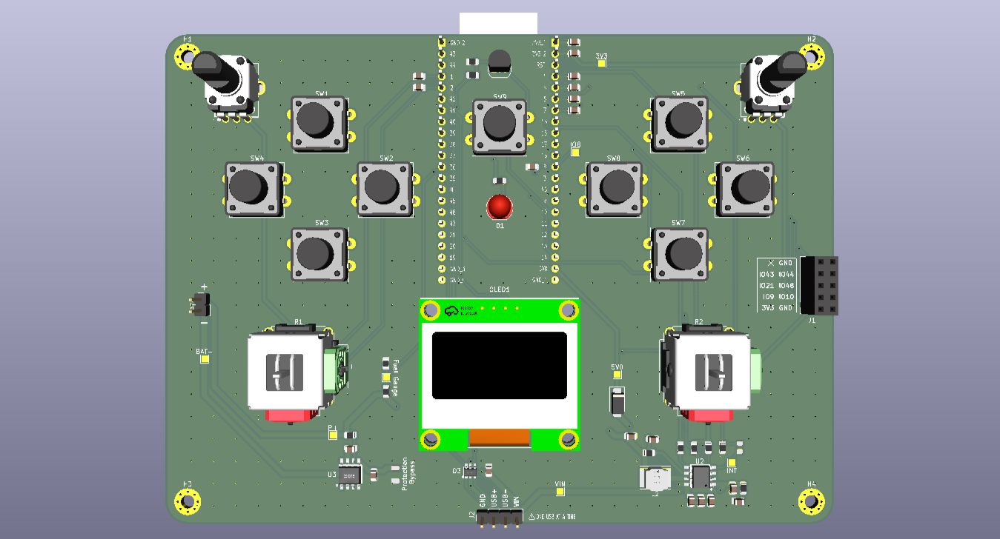
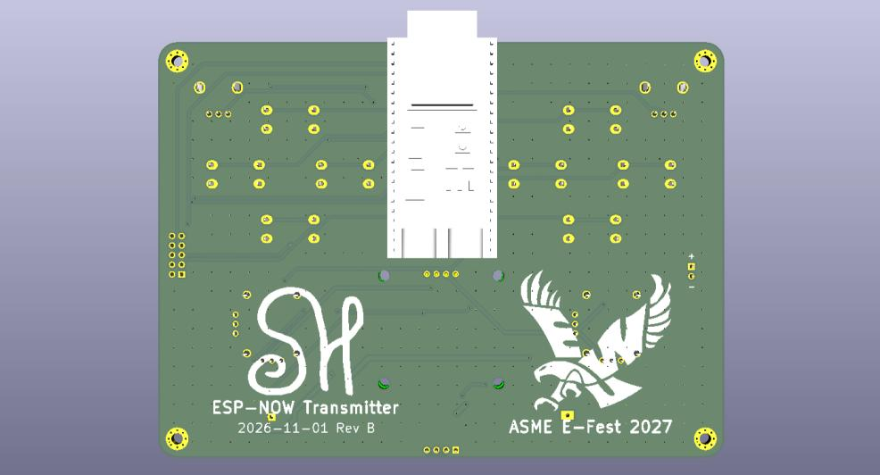
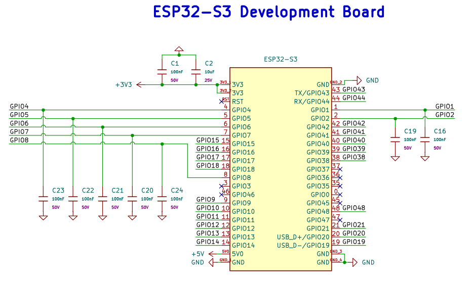
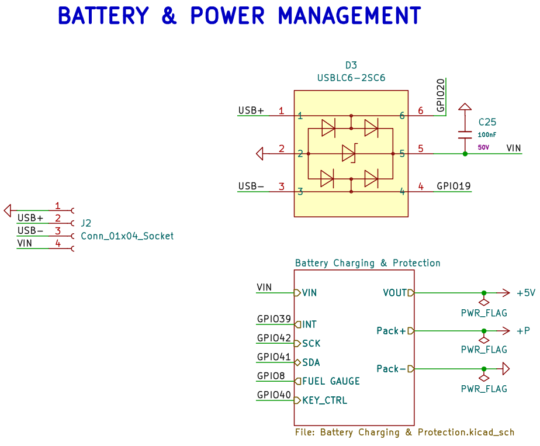
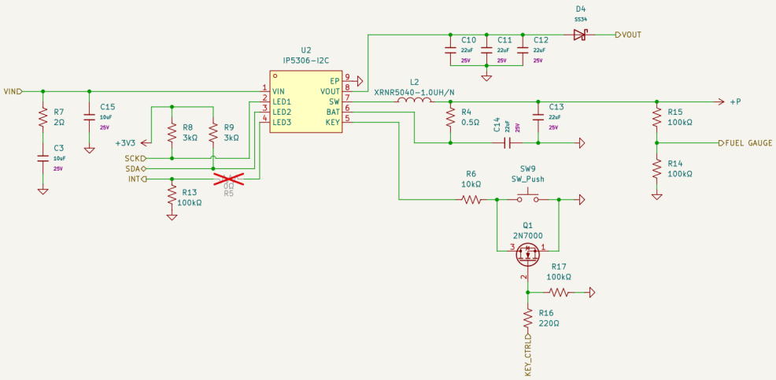
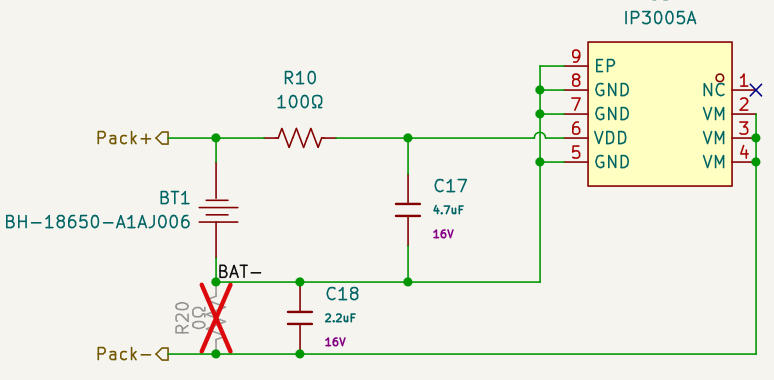
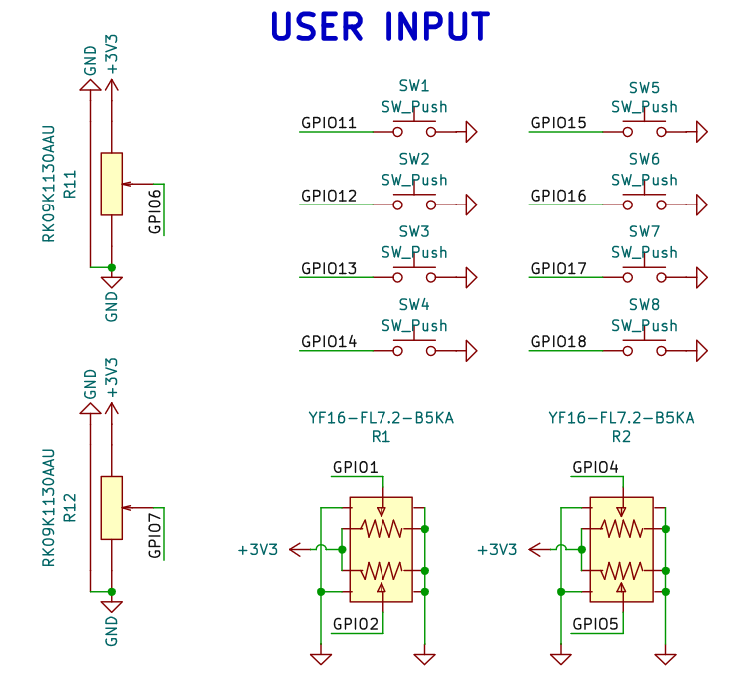
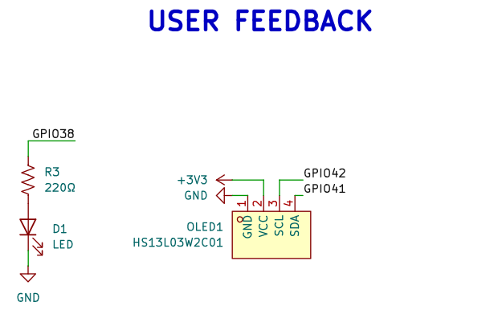
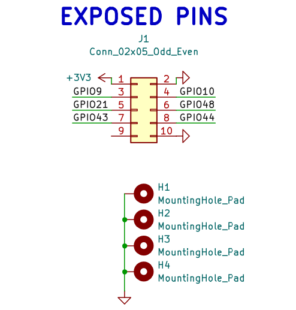
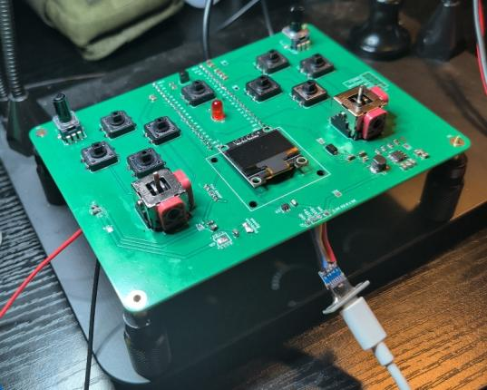

# EWU ASME SDC 2027 Transmitter

> A custom handheld Operator Console for the EWU ASME chapter's 2027 ASME Student Design Competition robot, built around an ESP32-S3 on a custom PCB and talking to the robot over ESP-NOW. **Work in progress.**

<p align="center">
  
</p>

> This repo covers only the transmitter. The competition rules, playfield models, and the robot itself are in the main repo: [EWU-ASME-SDC-2027-Robot](https://github.com/SethHibpshman/EWU-ASME-SDC-2027-Robot).

## Table of Contents

- [Overview](#overview)
- [Status](#status)
- [Functionality](#functionality)
- [System Design](#system-design)
- [Bill of Materials](#bill-of-materials)
- [Author](#author)
- [AI Disclosure](#ai-disclosure)
- [License](#license)

## Overview

The 2027 ASME Student Design Competition (eFest SDC), PODIUM, has one robot compete in five Disciplines. Each Run starts with a 30-second autonomous phase and ends with a 2-minute crewed phase, where the team drives the robot through its own Operator Console. The rules allow exactly one control link on a license-free band, the robot must be able to be disabled from the remote, and any battery in the remote must be a commercially made cell.

Instead of reusing the hobby RC radio from the [2026 robot](https://github.com/SethHibpshman/EWU-ASME-SDC-2026-Robot), this project is a purpose-built controller: an ESP32-S3 dev board on a custom PCB with joysticks, potentiometers, buttons, a display, and its own rechargeable battery system. Reliability comes first, followed by learning C/C++, building transferable skills, and a clean-looking design.

## Status

| Stage | State |
|---|---|
| Rev A PCB | Designed for JLCPCB assembly, not built (over $100 for two units) |
| Rev B PCB | Ordered, hand-assembled, and tested |
| Firmware | Not started |

## Functionality

### Inputs and Feedback

The layout follows a typical RC transmitter: two joysticks, two potentiometers, and eight buttons in two diamond clusters of four.

| Feature | Part |
|---|---|
| **Microcontroller** | ESP32-S3-DevKitC-1 N16R8 (dual USB-C) in female headers |
| **Drive inputs** | 2x 2-axis analog joysticks (YF16-FL7.2-B5KA, 5 kΩ) |
| **Proportional inputs** | 2x rotary potentiometers (RK09K1130AAU, 10 kΩ) |
| **Buttons** | 8x 12 mm action buttons and a power button |
| **Display** | 128x64 I2C OLED (HS13L03W2C01) |
| **Status lights** | 5 mm center LED and the devkit's built-in LED |
| **Expansion** | 2x5 header for spare GPIO |
| **Mounting** | 4 grounded M3 holes, one in each corner |

### Wireless Link

The transmitter uses ESP-NOW on 2.4 GHz, Espressif's connectionless peer-to-peer protocol. It needs no router, has millisecond-level latency, and gives two-way telemetry between the robot and the transmitter.

| Radio | Rough Range | Needs Infrastructure? | Power | Best For |
|---|---|---|---|---|
| Wi-Fi | Tens of metres | Router plus internet | Moderate to high | Dashboards, apps, cloud |
| **ESP-NOW** | Similar to Wi-Fi, more outdoors | None | Low | Board-to-board messaging |
| LoRa | Hundreds of metres to kilometres | LoRa module, gateway for LoRaWAN | Very low | Remote, sparse sensors |

LoRa's range isn't needed for a pilot a few metres from the board, and its small packets limit how fast data can be sent. Wi-Fi needs a router.

### Power

| Feature | Part |
|---|---|
| **Battery** | Single Li-ion cell |
| **Charger and 5 V boost** | IP5306-I2C |
| **Battery protection** | IP3005A, with a bypass jumper (R20) |
| **USB ESD protection** | USBLC6-2SC6 |
| **Backfeed blocking** | SS34 Schottky on the boost output |
| **Soft shutdown** | 2N7000 on the IP5306 KEY pin, driven by the MCU |
| **Fuel gauge** | 100 kΩ / 100 kΩ divider to an ADC pin |

The I2C version of the IP5306 was chosen so the MCU can turn off its auto-shutoff, which would otherwise cut power after 30 seconds of low current draw. Over I2C the MCU can also read charging state and battery level.

## System Design

### Hardware

<p align="center">
  
</p>

The back of the board carries the author's maker's mark, the board name, date and revision, and the EWU insignia for the team behind the eFest project.

Designed in KiCad 10 as a two-sheet schematic: the [main sheet](/assets/schematic/schematic_main.svg) (ESP32-S3, inputs, display, and expansion header) and a [Battery Charging & Protection sheet](/assets/schematic/schematic_power.svg). All project files are in [`/hardware/kicad_project_files`](/hardware/kicad_project_files).

#### ESP32-S3 Development Board

<p align="center">
  
</p>

- 100 nF and 10 µF capacitors on the 3V3 rail: the 100 nF handles fast logic switching spikes, the 10 µF covers radio transmit bursts (~250 mA) before the regulator catches up.
- 100 nF on each analog input forms an RC low-pass filter with the pot or joystick (cutoff ~637 Hz for the 10 kΩ pots, ~1.27 kHz for the 5 kΩ joysticks). User input passes through; the IP5306's ~500 kHz switching noise and 2.4 GHz radio noise are blocked.

#### Battery and Power Management

<p align="center">
  
</p>

USB data and VIN pass through the USBLC6-2SC6 ESD protection IC. The USB+ and USB- traces are routed together at matched length.

<p align="center">
  
</p>

The IP5306 circuit follows the manufacturer's I2C application schematic, with these changes:

- I2C pulled up to 3V3 instead of BATT+ to protect the MCU
- 100 kΩ / 100 kΩ fuel-gauge divider for a finer battery reading
- SS34 Schottky on VOUT to block backfeed when the devkit is on USB power
- 2N7000 on the KEY pin so the MCU can force a shutdown
- Flashlight LED removed and the exposed pad grounded
- INT routed through a jumper (R5) so its voltage can be checked before it reaches a GPIO

<p align="center">
  
</p>

The IP3005A battery protection IC is set up as the manufacturer recommends, with an optional jumper (R20) from BAT- to Pack- to bypass it.

#### User Input and Feedback

<p align="center">
  
  
</p>

The joysticks and pots run from 3V3 to GND. Buttons connect a GPIO to GND, with pull-ups handled in firmware.

#### Exposed Pins

<p align="center">
  
</p>

Spare usable GPIO is broken out to a 2x5 header for future expansion.

#### PCB


| Property | Value |
|---|---|
| Size | 150 x 110 x 1.6 mm, 2 layers |
| Routing | Back copper vertical, front copper horizontal |
| 1 mm traces | +P, BAT-, VIN, SW, VOUT |
| 0.5 mm traces | +5V, +3V3 |
| 0.2 mm traces | Signals |
| Ground | Poured on both layers, stitched with vias every 5 mm (under λ/10 at 2.4 GHz) |
| Finishing | Islands removed, teardrops added |

#### Rev A to Rev B

Rev B was a cost-cutting revision, going from over $100 to about $50 for two transmitters (about $25 each).

- Dropped JLCPCB assembly. The board is now hand-soldered in-house.
- Swapped 0603 passives for 0805 and gave hard-to-reach parts (like the inductor) hand-solder footprints.
- Replaced the SMD USB-C port with a 1x4 header (VIN, GND, USB+, USB-) wired to the ESP32-S3's native USB, so a USB-C module can be added later.
- Added labeled test pads (VIN, +P, BAT-, 3V3, 5V0, INT, fuel gauge, IO8) and back-side silkscreen.

#### Assembly and Bring-Up

<p align="center">
  
</p>

Assembly took about two hours, plus two hours of testing. SMD parts went on first, then through-hole. The devkit sits in female headers, so it stayed off the board while the power section was tested from a 3.7 V bench supply.

| Fault | Cause | Fix |
|---|---|---|
| Boost output 2 V instead of 5 V | IP5306 exposed pad not soldered to ground | Reflowed the pad from the back through the via with flux |
| No USB device through J2 | USB+ open between USBLC6 and GPIO20 | Resoldered the USBLC6 |

With both fixed, the boost reads 5 V, a cell charges from 4.0 V to 4.2 V on USB, and the board enumerates through J2. The battery protection IC was out of stock, so it was left off and bypassed with R20.

### Software

Firmware will be C++ on the Arduino-ESP32 core. As a fail-safe, the robot stops all operations if it stops receiving packets from the transmitter.

```
EWU-ASME-SDC-2027-Transmitter/
├── assets/
│   ├── pcb_render_front.png                     # 3D render of the PCB, front
│   ├── pcb_render_back.jpg                      # 3D render of the PCB, back
│   ├── pcb_assembled.jpg                        # Photo of the assembled Rev B board
│   └── schematic/                               # Schematic sheets (SVG) and section images
└── hardware/
    ├── kicad_project_files/
    │   ├── transmitter.kicad_pro                # KiCad project
    │   ├── transmitter.kicad_sch                # Main schematic sheet
    │   ├── Battery Charging & Protection.kicad_sch
    │   └── transmitter.kicad_pcb                # PCB layout
    └── fabrication/                             # JLCPCB outputs
        ├── gerber/                              # Gerbers and drill files
        └── production_files/                    # BOM, CPL, and Gerber zip
```

## Bill of Materials

The full BOM with LCSC part numbers is in [`BOM-transmitter.csv`](/hardware/fabrication/production_files/BOM-transmitter.csv). Rev B costs about $25 per transmitter, with a minimum PCB order of 5.

## Author

**Seth Hibpshman**  
Student of Electrical Engineering, Eastern Washington University

## AI Disclosure
_AI (LLM) tools were used in the drafting and editing of this README._

## License

[GNU General Public License v3.0](LICENSE)
